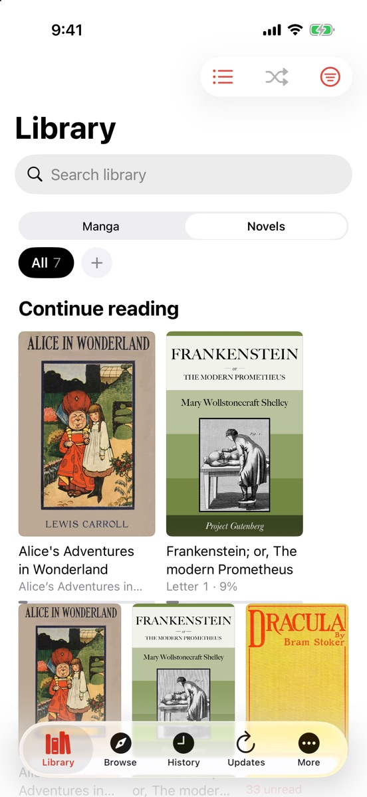
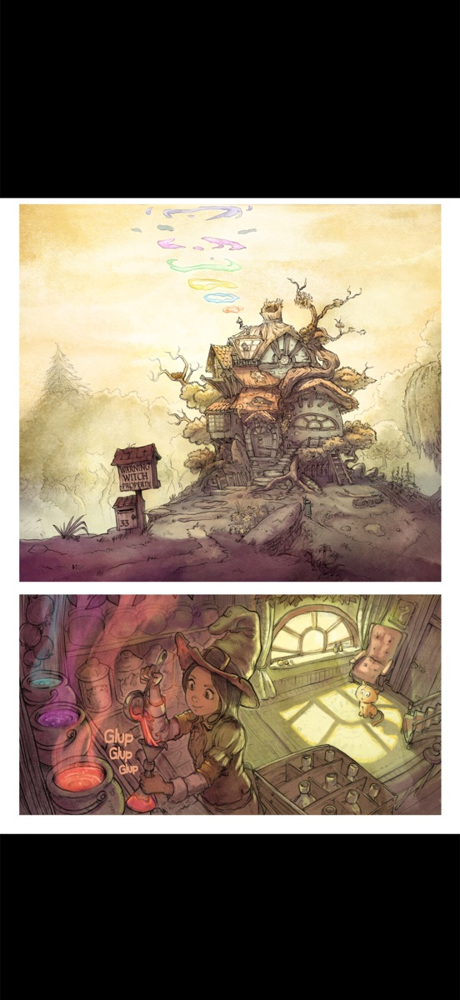
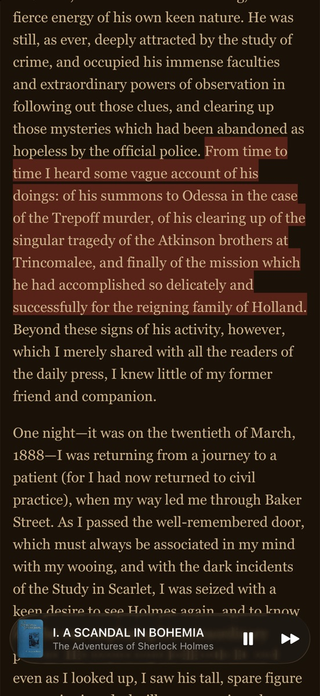

  

<h1 align="center">Yomi</h1>

Manga, webtoons and light novels in one free iPhone app. No ads, no subscription, no account.

  
  
  

  <a href="https://testflight.apple.com/join/Jgz5CYRg"><b>Join the beta on TestFlight</b></a> · iPhone, iOS 26 or later 
  <a href="https://yomi-reader.web.app">yomi-reader.web.app</a>

  
  
  

Built by one developer with AI coding help.

## Features

- **Manga and webtoons** — webtoons scroll as one long strip, manga turns page by page; download chapters to read offline
- **Light novels** — your choice of font and theme, find in chapter, and read-aloud that highlights the current sentence
- **Your own files** — CBZ, ZIP, CBR, CB7 and EPUB from Files, iCloud Drive or AirDrop
- **Your own server** — OPDS catalogs and Suwayomi; the address and password stay on your phone
- **Extensions** — from repositories you add: Yomi, LNReader and Mihon / Tachiyomi (Mihon extensions run on the phone)
- **Move in easily** — import a Mihon (`.tachibk`) or Tachimanga (`.tmb`) backup

## Yomi comes empty

Yomi is a reader. It includes **no sources and no content**. Read your own files, or add a **repository** (a list of
extensions published by another project) by pasting its link: **Browse → Extensions → Add Repository**. Then add the
extensions you want and open them under **Browse → Sources**.

Repositories are run by their own projects and are not part of Yomi. You are responsible for the repositories you add
and for using sources you are allowed to use.

**Formats Yomi reads:** Yomi JSON catalogs (`index.json`), LNReader plugin lists, and Mihon / Tachiyomi repositories
(`index.min.json` / `index.pb`). To write your own plugin, see [docs/EXTENSIONS.md](docs/EXTENSIONS.md).

## Moving from Mihon, Tachiyomi or Tachimanga

Export a backup from your old app (Mihon / Tachiyomi: **More → Backup → Create backup**; Tachimanga: a `.tmb` export),
then in Yomi go to **More → Backup → Import Backup**. Library, categories, history and repositories are added to what
you already have — nothing in Yomi is overwritten.

## Official links

The only official places for Yomi are **[yomi-reader.web.app](https://yomi-reader.web.app)** and **this GitHub
repository**. Any other download, store listing or "Yomi" account is not from this project.

## Help and contributing

Bug reports and feature requests: [open an issue](https://github.com/PacoDealer/Yomi/issues) or write to
yomiappreader@gmail.com. Problems with one source: check that website first. See [CONTRIBUTING.md](CONTRIBUTING.md)
and, for security issues, [SECURITY.md](SECURITY.md).

## Licence

[Mozilla Public License 2.0](LICENSE): you can use, study and build on Yomi; changes to Yomi's own files stay open
under the same licence. Some parts keep their own licences — see [NOTICE](NOTICE).

Screenshots show public-domain books from Project Gutenberg and [Pepper & Carrot](https://www.peppercarrot.com) by
David Revoy, CC BY 4.0.
